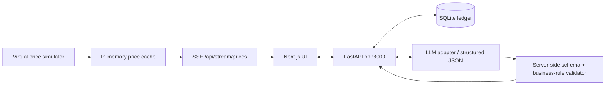

# FinAlly — AI Agents Capstone Project Guide

> **Source-coverage note:** The three uploaded recordings were inspected through regular screen samples and cross-checked against matching public course notes and the public project specification. A complete speech-to-text transcript was unavailable. The guide therefore does not claim to capture every spoken-only detail. This project is for simulated trading only; it must not connect to real brokerage accounts or execute real-money orders.

## Project goal
Build a Bloomberg-inspired local workstation with a watchlist, simulated market prices, a virtual portfolio, portfolio charts, and an AI assistant that proposes or applies actions to the simulated ledger. The purpose is to demonstrate controlled AI-assisted full-stack software development.

## Architecture
- **Frontend:** Next.js + TypeScript + Tailwind CSS, static export.
- **Backend:** FastAPI, Python managed with `uv`.
- **Persistence:** SQLite.
- **Streaming:** Server-Sent Events (SSE) on `GET /api/stream/prices`.
- **LLM integration:** Keep provider access behind an adapter; use structured output and server-side validation. Begin with deterministic mock mode.
- **Market data:** Built-in simulator by default; optional external market-data adapter is not required for v1.
- **Deployment:** One Docker container serves static frontend plus API on port 8000.



## Core features
1. Seed 10 watchlist tickers: AAPL, GOOGL, MSFT, AMZN, TSLA, NVDA, META, JPM, V, NFLX.
2. Start with $10,000 in virtual cash.
3. Show simulated prices, selected-symbol chart, sparkline, portfolio heatmap, P&L history, positions table and chat panel.
4. Support simulated market-style buy/sell actions only.
5. Persist profile/cash, watchlist, positions, trades, snapshots and chat messages in SQLite.
6. Use an LLM response schema with `message`, `trades`, and `watchlist_changes`; validate every action before changing state.

## Folder structure
```text
finally/
├── CLAUDE.md
├── AGENTS.md                   # optional shared instructions for other agents
├── .env.example
├── planning/
│   ├── PLAN.md                 # single source of truth
│   ├── API_CONTRACT.md
│   ├── TASKS.md
│   └── reviews/
├── frontend/
├── backend/
│   ├── app/
│   ├── db/
│   └── tests/
├── db/                         # runtime volume mount
├── test/
├── scripts/
└── Dockerfile
```

## Plan before coding
Create `planning/PLAN.md` with vision, feature requirements, non-goals, architecture boundaries, API endpoints and acceptance criteria. Do not start multiple coding agents until the plan and API contract are stable.

### `CLAUDE.md`
```md
# FinAlly - Finance Ally

Project-wide requirements, architecture, and rules live in planning/.
The plan is the single source of truth; read it before doing work.

@planning/PLAN.md

Before editing: restate your task, identify owned files, and check the API contract.
After editing: run relevant tests and summarize changed files and remaining risks.
```

## Agent roles
- **Lead/planner:** owns scope, plan, API contract and integration decisions.
- **Backend engineer:** FastAPI routes, domain services, SQLite and backend tests.
- **Market-data engineer:** simulator, price cache and SSE stream.
- **Frontend engineer:** dashboard, charts, EventSource hook and REST client.
- **LLM integration engineer:** prompt, structured output schema, mock mode and safe validation handoff.
- **QA/reviewer:** read-only review, tests and severity-ranked findings.

### Implementation sequence
1. Review scope and resolve ambiguities.
2. Freeze API contract and file ownership.
3. Build health endpoint, DB initialization and portfolio read.
4. Implement virtual trading service and validation.
5. Implement simulator, cache and SSE.
6. Build UI components against the contract.
7. Add LLM adapter and mock mode.
8. Integrate frontend/API/SQLite; test persistence.
9. Build Docker image and run end-to-end checks.
10. Run a read-only review and resolve high-severity findings.

## Backend endpoints
| Method/path | Purpose |
|---|---|
| `GET /api/health` | Container health check |
| `GET /api/watchlist` | Watchlist plus simulated prices |
| `POST /api/watchlist` | Add ticker |
| `DELETE /api/watchlist/{ticker}` | Remove ticker |
| `GET /api/portfolio` | Cash, positions, value and P&L |
| `POST /api/portfolio/trade` | Validate and execute a simulated trade |
| `GET /api/portfolio/history` | Value snapshots |
| `GET /api/stream/prices` | SSE price stream |
| `POST /api/chat` | Assistant message and validated action results |

### Server-side trade checks
- Ticker is valid and supported.
- Quantity is positive and side is `buy` or `sell`.
- Buy cost does not exceed virtual cash.
- Sell quantity does not exceed virtual shares owned.
- Cash, positions and trade history update atomically.
- AI output goes through the same service as manual actions; the model never writes to SQLite directly.

## LLM output schema
```json
{
  "message": "A concise, data-based explanation",
  "trades": [
    {"ticker": "AAPL", "side": "buy", "quantity": 2}
  ],
  "watchlist_changes": [
    {"ticker": "PYPL", "action": "add"}
  ]
}
```

Start in `LLM_MOCK=true` mode. Only enable a provider API key after the schema and validation tests pass. Keep `.env` untracked and never expose keys to frontend code.

## Example environment template
```dotenv
OPENROUTER_API_KEY=replace_me_locally
MASSIVE_API_KEY=
LLM_MOCK=true
```

## Docker run path
```bash
docker build -t finally .
docker run --name finally-app -p 8000:8000 \
  --env-file .env -v finally-data:/app/db finally
curl http://localhost:8000/api/health
docker stop finally-app
docker rm finally-app
```

Confirm actual file paths and module names in your generated starter repository before running. The command for the backend entry point may differ depending on how the agent scaffolds it.

## Testing checklist
- [ ] Price simulator returns valid positive prices.
- [ ] SSE emits and reconnects.
- [ ] Buy/sell operations update virtual cash and positions exactly once.
- [ ] Insufficient cash and overselling are rejected without state mutation.
- [ ] LLM malformed JSON/invalid actions are rejected.
- [ ] Watchlist add/remove works.
- [ ] Portfolio snapshots render in a value-history chart.
- [ ] Mock-mode chat produces deterministic test responses.
- [ ] Docker starts on port 8000 and persists SQLite state across restarts.
- [ ] UI clearly labels prices and positions as simulated.
- [ ] No real brokerage endpoints or credentials exist.

## Course techniques from lectures 12-14
- A custom slash command is a reusable saved prompt; `.claude/commands/doc-review.md` can include `$ARGUMENTS` to pass a document name.
- A sub-agent uses a separate context and is useful for isolated tasks such as read-only review.
- Hooks connect lifecycle events to automated actions; keep them narrow, visible and non-destructive.
- Skills/plugins package reusable commands, skills, sub-agents and hooks; add them only after the core app works.
- Sandboxing and remote execution can reduce risk or support parallel work; inspect every diff and use least privilege.
- Large codebases benefit from concise root instructions, local documentation, stable contracts, bite-sized changes and robust tests.
- The Agent SDK is an optional way to drive a coding agent programmatically, not a requirement for this capstone.

## Troubleshooting
| Symptom | Likely fix |
|---|---|
| Port 8000 busy | Stop conflicting service or use `-p 8001:8000`. |
| UI cannot reach API | Check API contract, dev proxy and relative `/api/*` paths. |
| Prices freeze | Check SSE route, event source errors and background price task. |
| Chat fails | Enable mock mode first; then check env key, provider config and schema. |
| State resets | Check DB path and named Docker volume mount. |
| Agents overwrite files | Stop, restore Git checkpoint, define ownership and work in smaller patches. |

## Sources
- [The FiNALLY project: your multi-agent capstone](https://vibe-engineering-smit-web.vercel.app/class12-finally-project.html)
- [Custom slash commands](https://vibe-engineering-smit-web.vercel.app/class12-slash-commands.html)
- [Agents and sub-agents](https://vibe-engineering-smit-web.vercel.app/class12-subagents.html)
- [Hooks](https://vibe-engineering-smit-web.vercel.app/class12-hooks.html)
- [Plugins and marketplaces](https://vibe-engineering-smit-web.vercel.app/class12-plugins-marketplaces.html)
- [Native sandbox](https://vibe-engineering-smit-web.vercel.app/class13-native-sandbox.html)
- [Claude Code on the Web](https://vibe-engineering-smit-web.vercel.app/class13-claude-on-web.html)
- [Working on large team codebases](https://vibe-engineering-smit-web.vercel.app/class14-large-codebases.html)
- [Driving Claude Code with the Agent SDK](https://vibe-engineering-smit-web.vercel.app/class14-agent-sdk.html)
- [FinAlly project specification](https://github.com/ed-donner/finally/blob/main/planning/PLAN.md)
- [FinAlly repository](https://github.com/ed-donner/finally)
